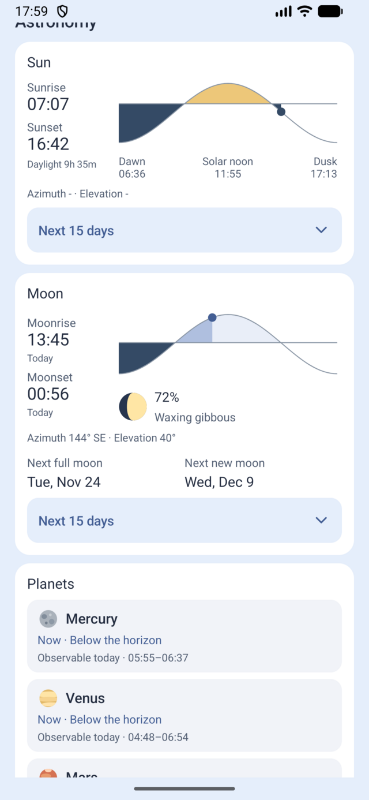

# SkyHere

SkyHere is an Android app for local weather, precipitation radar, and skywatching. Use your current location or choose a saved city. The interface follows Android’s language settings and is available in English and Italian.

## Screenshots

<p>
  
  
  
</p>

## Features

- Current conditions for the phone's location, with manual search and saved locations.
- Pull down from the top of the forecast to refresh it manually. The app also refreshes when you return after five minutes or when the local hour changes.
- A scrollable 24-hour forecast and a 10-day forecast with a detail screen for each day.
- Hourly charts for precipitation amount and probability, wind and gusts, humidity, and actual and feels-like temperatures.
- Interactive precipitation radar for Italian locations. Pan and zoom the map, scrub through the previous hour, or play the observed five-minute frames with a short crossfade.
- Illustrated weather conditions, including separate symbols for rain, showers, snow, and hail. [Weather icon catalog](docs/weather-icons.html)
- Matching Sun and Moon path charts with a marker for the current position. Azimuth and elevation update every minute while the app is open and are shown when the body is at or above the horizon.
- Sunrise, solar noon, sunset, civil twilight, polar night, and midnight sun. The expandable 15-day table shows maximum solar elevation and second-resolution sunrise, sunset, and daylight duration.
- Current Moon phase and illuminated percentage, dates of the next full and new moons, and an expandable 15-day table with phases, illumination, and second-resolution moonrise and moonset.
- Today’s estimated clear-sky viewing windows for Mercury, Venus, Mars, Jupiter, and Saturn, with live compass direction, azimuth, elevation, and apparent magnitude when above the horizon.
- Solar and lunar eclipses and planetary transits visible from the selected location, with local times, visible duration, and links to event details.
- Light, Dark, and System themes, layouts that adapt to larger Android text sizes, and an adaptive crescent-and-horizon launcher icon.
- Configurable units and time format. Defaults are °C, km/h, hPa, and a 24-hour clock. Precipitation is shown in mm.

## Data sources

- Forecasts and location search come from Open-Meteo. Where available, the app uses ItaliaMeteo/ARPAE ICON-2I for the first three days and ECMWF IFS for the extended forecast. Best Match fills in missing forecast fields. [Open-Meteo](https://open-meteo.com/) · [ICON-2I](https://open-meteo.com/en/docs/italia-meteo-arpae-api)
- Open-Meteo supplies rise and set times for the Sun and Moon and daily lunar phase values. SkyHere calculates daylight duration, lunar illumination, primary lunar phase dates, solar noon, civil twilight, and approximate planetary positions and magnitudes on the device. [Open-Meteo forecast API](https://open-meteo.com/en/docs) · [NOAA solar equations](https://gml.noaa.gov/grad/solcalc/solareqns.PDF) · [Paul Schlyter's orbital calculations](https://www.stjarnhimlen.se/comp/ppcomp.html)
- The radar overlays estimated surface rainfall intensity from Radar-DPC on an OpenStreetMap basemap. The radar data and colorized overlay are attributed to Radar-DPC under CC BY-SA 4.0. The map uses Leaflet. [Radar-DPC](https://mappe.protezionecivile.gov.it/it/mappe-e-dashboard-rischi/piattaforma-radar/) · [CC BY-SA 4.0](https://creativecommons.org/licenses/by-sa/4.0/) · [OpenStreetMap attribution](https://www.openstreetmap.org/copyright) · [Leaflet licence](app/src/main/assets/radar/LEAFLET-LICENSE)
- Eclipse data comes from IMCCE OPALE. Transit visibility windows are estimated using the selected location and the NASA catalog. [IMCCE OPALE](https://opale.imcce.fr/) · [Transit Predictions by Fred Espenak, NASA/GSFC](https://eclipse.gsfc.nasa.gov/transit/catalog/Visible.html)

The app asks for location access while in use. Android resolves the name of the detected location, and city search remains available if location access is denied or unavailable.

## Build and run

Use JDK 17 and Android SDK Platform 34. The app runs on Android 8.0 (API 26) or later. Set `ANDROID_HOME` to your SDK directory or open the project in Android Studio to configure it.

```sh
./gradlew :app:assembleDebug
```

To install the debug build on a connected device or running emulator:

```sh
./gradlew :app:installDebug
```

The installable debug APK is written to `app/build/outputs/apk/debug/app-debug.apk`. You can copy it to an Android device to install it for testing.
