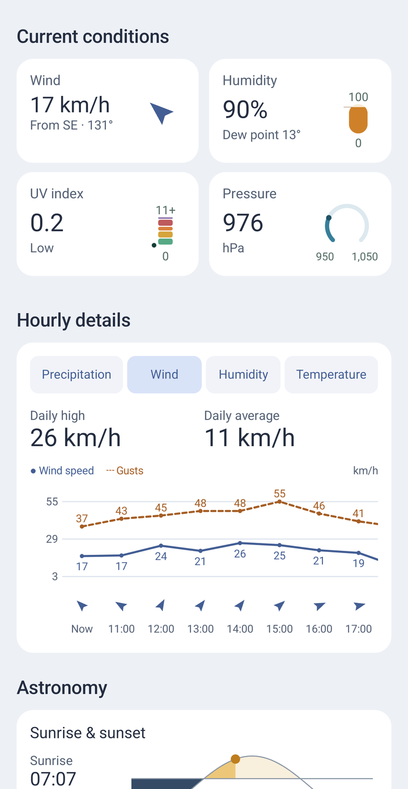
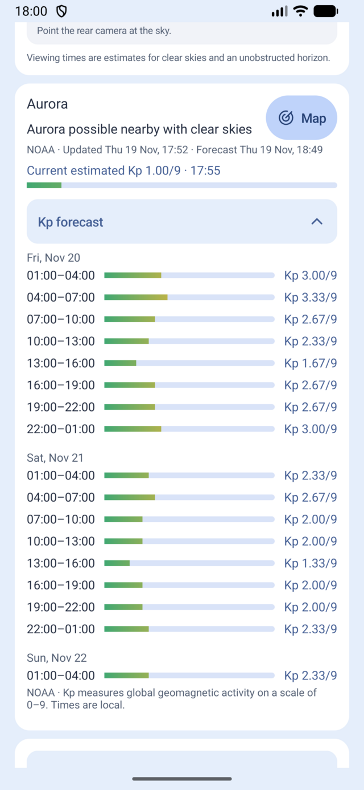
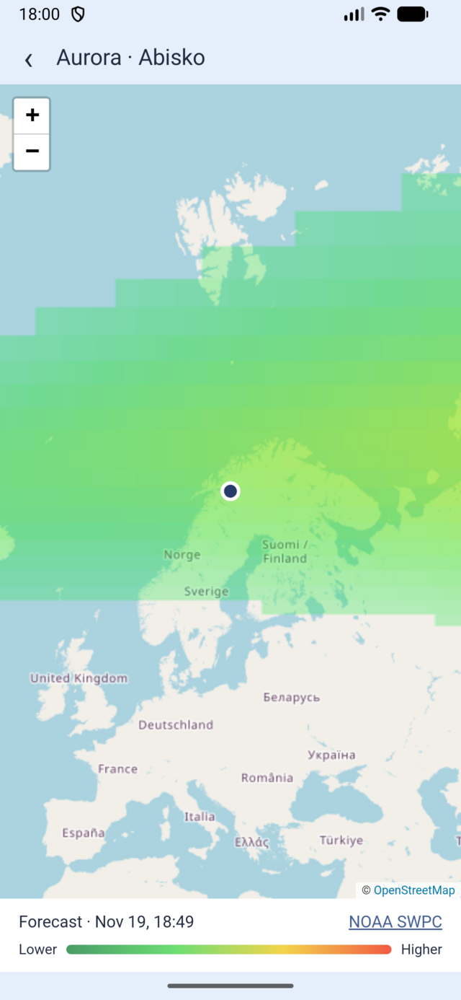
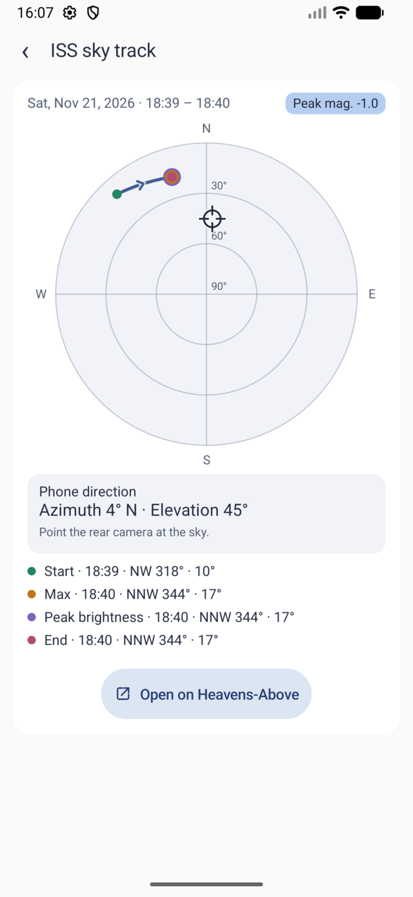
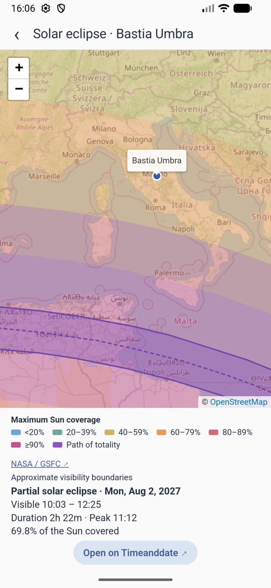
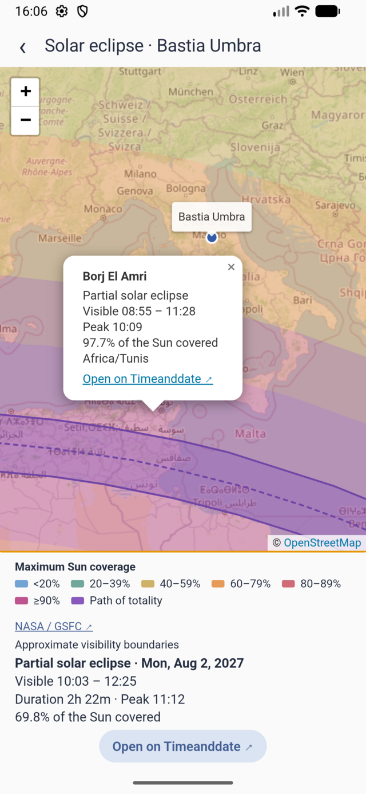
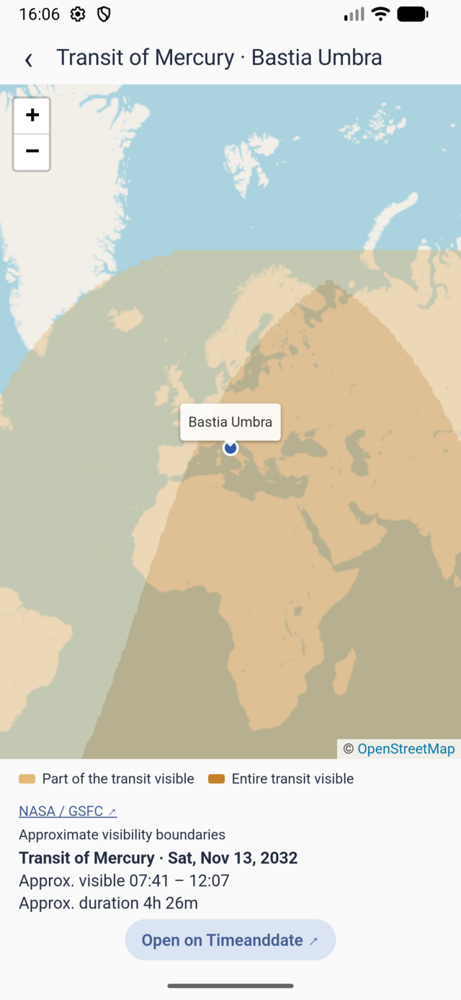
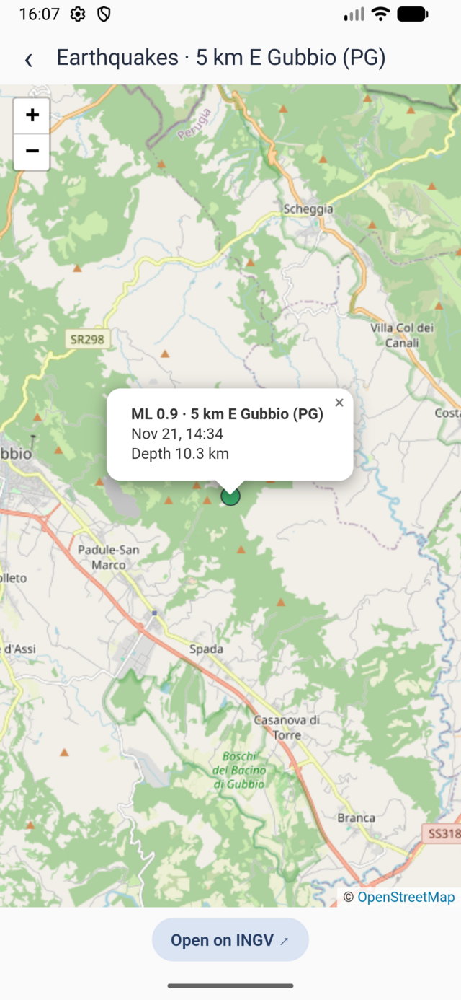

# SkyHere

SkyHere is an Android app for local weather, interactive maps, skywatching, and recent seismic activity in Italy. Use your current location or choose a saved city. The interface follows Android’s language settings and is available in English and Italian.

## Screenshots

<p>
  
  
  
</p>

<p>
  
  
  
</p>

<p>
  
  
  
</p>

<p>
  
</p>

## Features

- Current conditions for the phone's location, with manual search and saved locations.
- Pull down from the top of the forecast to refresh it manually. The app also refreshes when you return after five minutes or when the local hour changes.
- A scrollable 24-hour forecast and a 10-day forecast. Daily icons summarize the most frequent condition during daylight hours, with notable events and their approximate times in the day details.
- Hourly charts for precipitation amount and probability, wind and gusts, humidity, and actual and feels-like temperatures.
- Interactive precipitation radar for Italian locations. Pan and zoom the map, scrub through the previous hour, or play the observed five-minute frames with a short crossfade.
- Animated satellite imagery for Italian locations. Auto mode uses GeoColour for natural colours by day and thermal imagery at night. Infrared mode is also available. The map downloads only the visible area from Meteosat and reuses loaded frames during playback.
- Current European AQI category and PM2.5 and PM10 concentrations. For Italian locations, the air quality map shows the EEA’s modelled categories. Tap an area to see its category.
- Regional weather warnings for Italian locations, with the hazard, severity, validity period, and a link to MeteoAlarm.
- Illustrated weather conditions, including separate symbols for rain, showers, snow, and hail, plus high-contrast snowflakes. [Weather icon catalog](docs/weather-icons.html)
- Matching Sun and Moon path charts with a marker for the current position. Azimuth and elevation update every minute while the app is open and are shown when the body is at or above the horizon.
- Sunrise, solar noon, sunset, civil twilight, polar night, and midnight sun. The Sun card shows today’s maximum solar elevation. During polar night or midnight sun, the whole solar curve stays on one side of the horizon. The expandable 15-day table shows maximum solar elevation and second-resolution sunrise, sunset, and daylight duration.
- Current Moon phase and illuminated percentage, dates of the next full and new moons, and an expandable 15-day table with phases, illumination, and second-resolution moonrise and moonset.
- Today’s estimated clear-sky viewing windows for Mercury, Venus, Mars, Jupiter, and Saturn. A green status, coordinates, and access to the sky track appear during a viewing window. Apparent magnitude is shown while the planet is above the horizon.
- Full-screen polar sky charts for the Sun, Moon, planets, and ISS. The Moon and planet tracks show the portions where the Sun is below the horizon. The live reticle follows the rear camera’s direction above the horizon when geographic north is available. The panel shows the phone’s azimuth and elevation and labels magnetic readings when geographic north is unavailable.
- Visible ISS passes for the next seven days, with local times, direction of travel, maximum elevation, peak brightness, and a Heavens-Above link. SkyHere saves the orbital elements on disk and reuses them across restarts and location changes.
- Short-term aurora visibility estimates for either hemisphere, based on nearby auroral activity, darkness, and cloud cover. The interactive map shows the NOAA forecast and the selected location. The card also shows the latest estimated Kp and upcoming three-hour Kp forecasts on a scale of 0–9, in local time.
- Maps for solar and lunar eclipses and for Mercury and Venus transits. Solar maps show maximum Sun coverage in percentage bands and the path of totality or annularity where applicable. Lunar and transit maps distinguish full and partial visibility. Tap any point for its local times, eclipse coverage and totality duration where available, and a location-specific details link. Calculated visibility boundaries are approximate.
- The Seismic activity section is available for Italian locations and shows INGV earthquakes from the last seven days near the phone’s current location. The default radius is 50 km and can be set from 1 to 500 km in Settings. The list shows magnitude, local time, distance, and depth. The overview map shows the search area and uses the same magnitude colours as the list, with larger markers for higher magnitudes. Tapping an event in the list opens a map centered on its epicenter with a direct link to its INGV record.
- Light, Dark, and System themes, layouts that adapt to larger Android text sizes, and an adaptive crescent-and-horizon launcher icon.
- Configurable units and time format. Defaults are °C, km/h, hPa, and a 24-hour clock. Precipitation is shown in mm.

## Data sources

- Forecasts and location search come from Open-Meteo. Where available, the app uses ItaliaMeteo/ARPAE ICON-2I for the first three days and ECMWF IFS for the extended forecast. Best Match fills in missing forecast fields. [Open-Meteo](https://open-meteo.com/) · [ICON-2I](https://open-meteo.com/en/docs/italia-meteo-arpae-api)
- Open-Meteo supplies rise and set times for the Sun and Moon and daily lunar phase values. SkyHere calculates daylight duration, lunar illumination, primary lunar phase dates, solar noon, civil twilight, and approximate planetary positions and magnitudes on the device. [Open-Meteo forecast API](https://open-meteo.com/en/docs) · [NOAA solar equations](https://gml.noaa.gov/grad/solcalc/solareqns.PDF) · [Paul Schlyter's orbital calculations](https://www.stjarnhimlen.se/comp/ppcomp.html)
- The radar overlays estimated surface rainfall intensity from Radar-DPC on an OpenStreetMap basemap. The radar data and colorized overlay are attributed to Radar-DPC under CC BY-SA 4.0. The map uses Leaflet. [Radar-DPC](https://mappe.protezionecivile.gov.it/it/mappe-e-dashboard-rischi/piattaforma-radar/) · [CC BY-SA 4.0](https://creativecommons.org/licenses/by-sa/4.0/) · [OpenStreetMap attribution](https://www.openstreetmap.org/copyright) · [Leaflet licence](app/src/main/assets/radar/LEAFLET-LICENSE)
- Satellite imagery comes from EUMETSAT Meteosat, with NASA Black Marble imagery in the GeoColour night view. The NOAA NESDIS infrared mosaic is available as a fallback. [EUMETSAT GeoColour](https://user.eumetsat.int/catalogue/EO:EUM:DAT:0913) · [NOAA NESDIS](https://www.ospo.noaa.gov/products/imagery/gmgsi/)
- The air quality card uses CAMS data from Open-Meteo. The map comes from the European Environment Agency’s modelled air quality index, published on a 1 km grid. [Open-Meteo Air Quality API](https://open-meteo.com/en/docs/air-quality-api) · [European Air Quality Index](https://airindex.eea.europa.eu/AQI/)
- Regional weather warnings come from the public MeteoAlarm Atom feed for Italy. [MeteoAlarm Italy](https://feeds.meteoalarm.org/feeds/meteoalarm-legacy-atom-italy)
- Aurora maps and short-term activity forecasts use NOAA SWPC’s OVATION model. SkyHere estimates local visibility using distance from the forecast activity, solar elevation, and Open-Meteo cloud cover. NOAA also provides the estimated and forecast global Kp index. [NOAA aurora forecast](https://www.spaceweather.gov/products/aurora-30-minute-forecast) · [Estimated Kp](https://services.swpc.noaa.gov/json/planetary_k_index_1m.json) · [Kp forecast](https://services.swpc.noaa.gov/products/noaa-planetary-k-index-forecast.json)
- SkyHere calculates ISS passes with SGP4 using orbital elements from AMSAT. [AMSAT orbital elements](https://www.amsat.org/keplerian-elements/) · [SGP4 license](app/src/main/assets/licenses/sgp4.txt)
- IMCCE OPALE supplies eclipse circumstances and lunar eclipse contacts. Solar coverage maps use the NASA/GSFC Besselian elements. Transit visibility is estimated from the NASA/GSFC catalog and the Sun’s elevation at the selected point. [IMCCE OPALE](https://opale.imcce.fr/) · [Solar eclipse elements, NASA/GSFC](https://eclipse.gsfc.nasa.gov/SEcat5/beselm.html) · [Transit predictions by Fred Espenak, NASA/GSFC](https://eclipse.gsfc.nasa.gov/transit/catalog/Visible.html)
- Earthquake data comes from the INGV FDSN Event API. INGV publishes its earthquake data under CC BY 4.0. [INGV earthquake list](https://terremoti.ingv.it/) · [INGV API documentation](https://github.com/INGV/openapi#fdsnws---event) · [CC BY 4.0](https://creativecommons.org/licenses/by/4.0/)

The app asks for location access while in use. Android resolves the name of the detected location, and city search remains available if location access is denied or unavailable.

## Build and run

Use JDK 17 and Android SDK Platform 34. The app runs on Android 8.0 (API 26) or later. Set `ANDROID_HOME` to your SDK directory or open the project in Android Studio to configure it.

```sh
./gradlew :app:assembleDebug
```

To install the debug build on a connected device or running emulator:

```sh
./gradlew :app:installDebug
```

The installable debug APK is written to `app/build/outputs/apk/debug/app-debug.apk`. You can copy it to an Android device to install it for testing.
